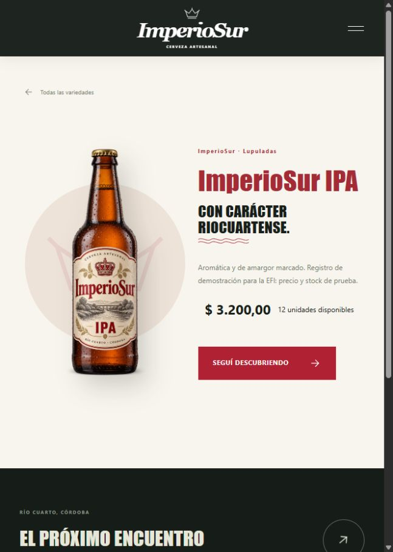

# ImperioSur — Frontend

Frontend de Cervecería ImperioSur, una marca de cerveza artesanal de Río Cuarto, Córdoba. Proyecto separado del backend Django, creado con Next.js App Router, React, JavaScript, Tailwind CSS y estilos propios. El inicio, el catálogo y las fichas consumen productos de la API Django.

## Abrir en Windows

Primero iniciar el backend en una terminal:

```powershell
cd "$env:USERPROFILE\Desktop\Cerveceria-EFI\Cerveceria-Backend"
uv sync --locked
uv run python manage.py migrate
uv run python manage.py runserver
```

En una segunda terminal, iniciar el frontend:

```powershell
cd "$env:USERPROFILE\Desktop\Cerveceria-EFI\ImperioSur-Frontend"
# En una copia nueva: npm ci
# Crear .env.local desde el ejemplo si todavía no existe:
Copy-Item .env.example .env.local
npm run dev
```

Entrar a http://127.0.0.1:3000/. Las dependencias ya están instaladas en esta PC. Para preparar una copia nueva, o reinstalar desde cero con el servidor detenido, ejecutar `npm ci` antes de `npm run dev`. Se necesita Node.js 20.9 o superior; se instaló Node.js LTS en esta PC. En `.env.local`, `NEXT_PUBLIC_API_URL=http://127.0.0.1:8000/api/` indica la API. Reiniciar Next.js al cambiar esa variable; en producción se configura antes de compilar.

Opcionalmente, desde la carpeta del backend, `uv run python manage.py cargar_catalogo_demo` carga las seis cervezas de muestra y sus imágenes desde Django. Conserva los datos de los productos ya existentes. Sus precios y stock son de prueba.


## Rutas y funcionamiento

- `/`: portada con carrusel de tres mensajes, controles anterior/siguiente y pausa; presentación de las variedades, esencia de la marca y origen.
- `/cervezas`: catálogo de la API con búsqueda, filtros por categoría, paginación y recuperación cuando no hay resultados.
- `/cervezas/[id]`: ficha de producto con descripción, imagen, precio y stock de Django. Los antiguos enlaces por estilo de la portada resuelven la ficha de la API cuando existe.
- Menú adaptable en móvil, cierre mediante Escape, enlaces internos y página 404.

## Animaciones

- Transiciones de texto y entrada de botellas en la portada.
- Zoom suave en la fotografía y desplazamiento de fondo al hacer scroll.
- Apariciones progresivas de secciones mediante IntersectionObserver.
- Movimiento de botellas, flechas y botones al pasar el mouse.
- Menú fijo que cambia al desplazarse.
- Pausa del carrusel, suspensión cuando la pestaña no está visible y respeto por `prefers-reduced-motion`.

## Alcance de esta versión

La integración de lectura funciona **en local**: la información del catálogo viene de la base de datos Django, incluyendo precios, stock e imágenes. Los productos cargados con el comando demo son datos de prueba; las fotografías y etiquetas son ilustrativas. La portada conserva textos editoriales de la marca.

Se consulta `GET /api/productos/` con `search`, `categoria`, `page` y `page_size`; las categorías se obtienen de `/api/categorias/`. El detalle devuelve IDs de categoría y marca, resueltos mediante sus endpoints de detalle. Las peticiones se cancelan al cambiar de consulta y tienen un tiempo límite. Se muestran carga, error con reintento, catálogo vacío, producto inexistente y reemplazo de imagen. No se sustituye una API caída por un catálogo inventado.

Usá la rama `main` de [ImperioSur-Backend](https://github.com/BenjaDeLauro/ImperioSur-Backend) para la API de catálogo y la autenticación. El frontend incluye login, cuenta y gestión de productos. El despliegue sigue pendiente.



## Archivos

- `app/`: páginas, layout y estilos globales.
- `components/`: marca, menú, portada, tarjetas, catálogo y efectos.
- `lib/cervezas.js`: contenido editorial y búsqueda.
- `lib/api.js`: contrato y peticiones a Django.
- `lib/productos.js`: presentación de productos y moneda argentina.
- `public/images/`: portada y etiquetas originales de ImperioSur.
- `docs/imagenes.md`: procedencia y prompts de las imágenes.

## Validación

```powershell
npm test
npm run build
```

Las siete pruebas de Vitest cubren búsqueda y filtros, parámetros de la API, validación del login, comprobación del origen, cookie HttpOnly, validación del formulario de productos y errores al guardar. El acceso sin sesión y el cierre de sesión se verifican manualmente.

## Gestión de productos

Entrá con una cuenta de Django marcada como personal (`is_staff`). Desde **Mi cuenta**, abrí **Gestionar catálogo**. En `/gestion/productos` podés listar, crear, editar y eliminar productos. El formulario de alta y edición valida con React Hook Form y Zod. Permite cargar una imagen JPG, PNG o WebP de hasta 4 MB y conserva la imagen anterior si no elegís otra.

El servidor de Next.js envía el token de sesión a Django, que vuelve a comprobar los permisos en cada escritura. Si un producto está en un pedido, Django rechaza la eliminación y el frontend muestra el motivo.

## Git y organización

Repositorio: [EstebanjsrZ/ImperioSur-Frontend](https://github.com/EstebanjsrZ/ImperioSur-Frontend).

- `develop` reúne los cambios de trabajo que revisa el equipo.
- `main` contiene la versión revisada.

Para el próximo cambio, creá una rama desde `develop` y abrí un PR hacia esa rama. Cuando esté revisado, integrá `develop` a `main`. Tablero: [EFI 2026 - Programación III - ImperioSur](https://github.com/users/EstebanjsrZ/projects/1).

## Integrantes y división acordada

| Integrante | Responsabilidad acordada del backend |
| --- | --- |
| Benjamín De Lauro | Estructura, coordinación e integración general |
| Esteban Rodríguez | Autenticación, templates y permisos; ampliación de modelos |
| Ignacio Piñeiro | API REST, serializers y ViewSets |

El frontend y las pruebas de integración corresponden al equipo. La propuesta visual y esta conexión local se registran como aportes de Esteban. Las tareas pendientes del equipo conservan su dependencia de la API y la revisión grupal.

## Autenticación

- `/login`: formulario con React Hook Form y Zod; utiliza un usuario existente del backend.
- `/cuenta`: página protegida que verifica la sesión en el servidor y muestra el usuario con Context API. Incluye layout, carga y error propios.
- El navegador llama a los Route Handlers `/api/auth/login`, `/api/auth/me` y `/api/auth/logout` de Next.js. Estos consultan `/api/auth/login/`, `/api/auth/me/` y `/api/auth/logout/` de Django.
- El token se guarda en una cookie de sesión HttpOnly y SameSite=Lax (Secure en producción); no se expone al contexto ni a localStorage. Next.js envía `Authorization: Token ...` a Django. Los POST verifican el origen para impedir solicitudes cruzadas.
- Logout revoca el token en Django y borra la cookie. Si el backend no responde, se muestra un error y se conserva la sesión para reintentar la revocación.
- Configurar `API_URL` para las peticiones del servidor; si se omite, se usa `NEXT_PUBLIC_API_URL`. En producción ambas deben apuntar a la API pública y el frontend debe servirse mediante HTTPS.
- AuthProvider, LoginForm y AccountPanel son Client Components por su estado y eventos; la página de cuenta verifica el token como Server Component. Cada futura operación protegida debe volver a validar la sesión y los permisos en el backend.

Para preparar una copia nueva: `npm ci`, copiar `.env.example` a `.env.local`, iniciar Django y ejecutar `npm run dev`. Verificar login inválido, login válido, recarga de `/cuenta`, logout y acceso directo a `/cuenta` sin sesión. Ejecutar `npm test` y `npm run build`.

## Formato del código

Usamos sangría de 2 espacios, etiquetas JSX anidadas en líneas separadas y un ancho orientativo de 80 caracteres. Prettier mantiene este formato sin cambiar el comportamiento de la aplicación.

- `npm run format`: ordena el código de páginas, componentes y utilidades.
- `npm run format:check`: comprueba el formato sin modificar archivos.

Para leer el login, seguir este recorrido: `app/login/page.js` presenta la página; `components/login-form.js` valida y envía los campos; `components/auth-provider.js` comparte la sesión; `app/api/auth/login/route.js` consulta Django y guarda la cookie. `app/cuenta/page.js` verifica la sesión antes de mostrar la cuenta.
